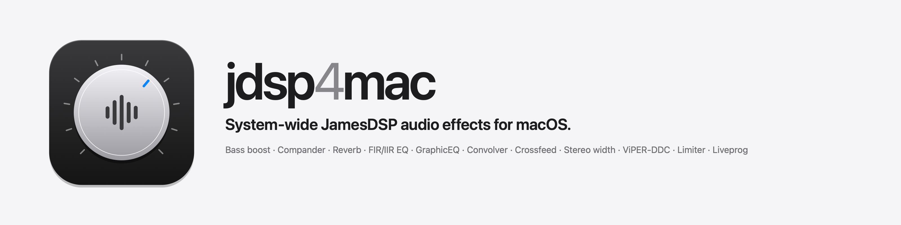
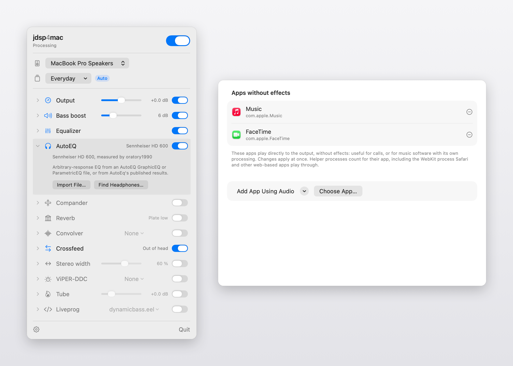

# jdsp4mac

<picture>
  <source media="(prefers-color-scheme: dark)" srcset="docs/images/readme-banner-dark.png">
  
</picture>

jdsp4mac puts JamesDSP on your Mac as a menu bar app. Everything your Mac plays goes through [libjamesdsp](https://github.com/james34602/JamesDSPManager), the same DSP engine behind JamesDSP for Android and [JamesDSP for Linux](https://github.com/Audio4Linux/JDSP4Linux). Audio comes in through a Core Audio process tap. There is no kernel extension, no virtual audio driver and nothing to reboot.

- **Effects.** Bass boost, FIR and IIR equalizer, AutoEQ arbitrary-response EQ, compander, reverb, convolver with impulse responses, BS2B and HRTF crossfeed, stereo width, ViPER-DDC, vacuum tube and liveprog EEL2 scripts.
- **Presets.** jdsp4mac uses the JamesDSP for Linux `audio.conf` format. It imports presets from JamesDSP for Linux, RootlessJamesDSP `.tar` backups and JamesDSP for Android `james.dsp.*.xml` files, and exports to Linux and RootlessJamesDSP. A preset can load by itself whenever a given output device becomes active.
- **AutoEQ.** Search the headphone profiles published by [AutoEq](https://github.com/jaakkopasanen/AutoEq) and apply one, or import a GraphicEQ or ParametricEQ file.
- **Apps without effects.** Pick apps that should skip the effects, such as FaceTime for calls. Safari works too.
- **`jdspctl`.** Command-line control with the same options as the JamesDSP for Linux remote, for scripts, Shortcuts and Raycast.

<picture>
  <source media="(prefers-color-scheme: dark)" srcset="docs/images/hero-dark.png">
  
</picture>

jdsp4mac needs macOS 14.4 or later on Apple silicon. I have only tested it on macOS 27.0.1 on an M1 Pro MacBook Pro.

## Install

jdsp4mac is free and only distributed here, so Apple has not notarised it. macOS blocks it the first time you open it, and you allow it once.

1. Download `jdsp4mac-<version>-arm64.zip` from [Releases](../../releases), unzip it and move `jdsp4mac.app` to Applications.
2. Open it. macOS shows **"jdsp4mac.app" Not Opened** and says Apple could not verify it is free of malware. Click **Done**, not Move to Bin.
3. Open **System Settings › Privacy & Security**, scroll down to Security and click **Open Anyway** next to the jdsp4mac message. Click **Open Anyway** again in the next dialog and confirm with Touch ID or your password.

   Control-click › Open stopped working for this in macOS Sequoia. If you prefer Terminal, this does the same:
   ```sh
   xattr -dr com.apple.quarantine /Applications/jdsp4mac.app
   ```
4. The jdsp4mac icon, a ring with three bars, appears in the menu bar. Click it and switch the power on. macOS asks whether jdsp4mac may record system audio. Click **Allow**. That is how it hears what your Mac plays. It records nothing and sends nothing anywhere.

If you clicked Don't Allow, the panel says there is no audio from the tap. Turn jdsp4mac on under **System Settings › Privacy & Security › Screen & System Audio Recording**, in the "System Audio Recording Only" list, then quit and reopen jdsp4mac.

Each release is signed separately, so macOS may ask for the audio recording permission again after an update.

## Use

Daily use happens in the menu bar panel. It has the power switch, the output device, presets and one row per effect. Click a row to open its settings. The switch on the **Output** row turns all effects off and on at once.

The panel works from the keyboard too. ↑ and ↓ move between effects, ← and → adjust the selected one, Space switches it on or off, Return opens its settings and Esc closes the panel.

The gear icon opens the settings window. It holds AutoEQ search, the liveprog script editor, the list of apps without effects, presets per output, open at login and diagnostics.

Your files live in `~/Library/Application Support/jdsp4mac/`.

| File or folder | Contents |
|---|---|
| `audio.conf` | Current settings in the JamesDSP for Linux format. Edits apply live. |
| `presets/` | Presets |
| `excluded-apps.txt` | Bundle IDs of apps that play without effects, one per line |
| `irs/`, `vdc/`, `liveprog/` | Impulse responses, ViPER-DDC files and liveprog scripts |

Presets from Linux point at files by their Linux path. jdsp4mac looks the files up by name in these folders instead.

### jdspctl

`jdspctl` ships inside the app. Link it into your PATH to use it from Terminal:

```sh
sudo mkdir -p /usr/local/bin && sudo ln -sf /Applications/jdsp4mac.app/Contents/MacOS/jdspctl /usr/local/bin/jdspctl
```

```sh
jdspctl --status
jdspctl --set bass_enable=true bass_maxgain=8
jdspctl --load-preset "My headphones"
jdspctl --list-devices
jdspctl --set-preset-rule "BuiltInSpeakerDevice=Speakers"
jdspctl --help
```

`jdspctl` edits the same files the app watches. Changes apply straight away while jdsp4mac runs, and they still work when it isn't running.

## Limitations

- Stereo only. Outputs with more than two channels play unprocessed.
- To leave out an app's helper processes, including the WebKit process Safari plays through, jdsp4mac asks macOS which app is responsible for each process. That is a private macOS call. If a future macOS drops it, only the app's own process gets excluded, and the log says so.
- Run one tap-based audio app at a time. Other apps that use process taps on the same output, FineTune for example, reportedly stop each other from starting. Quit them if jdsp4mac stays on "Starting".
- Long convolver impulse responses cost CPU in proportion to their length. On an M1 Pro a 5 s IR takes about 13 % of a core and a 20 s IR about 25 %. Typical room and headphone IRs are under 2 s.
- Apple has not notarised the app. See Install.

## Build from source

```sh
brew install xcodegen
xcodegen && xcodebuild -scheme jdsp4mac -configuration Debug build
```

Debug builds are ad-hoc signed by default, so macOS asks for the audio recording permission again after every rebuild. To keep the permission, sign them with a free Apple Development certificate as described in `xcconfig/Signing.xcconfig`.

`scripts/build-release.sh [version]` builds the ad-hoc signed release zip with `jdspctl` inside. On GitHub, Actions › build › Run workflow does the same and publishes a release for the version you enter. `scripts/screenshots.sh [dir]` renders the running app with demo settings for screenshots and saves nothing.

`Tests/golden.sh` checks the DSP offline. `Tests/phase2.sh`, `phase3.sh`, `phase5.sh` and `exclusion.sh` test the live app. They play quiet tones and need the audio recording permission.

## Credits and licence

- libjamesdsp is by James Fung ([JamesDSPManager](https://github.com/james34602/JamesDSPManager)). jdsp4mac uses the copy maintained in [JDSP4Linux](https://github.com/Audio4Linux/JDSP4Linux) by Tim Schneeberger, whose preset format and CLI it follows.
- Headphone profiles come from [AutoEq](https://github.com/jaakkopasanen/AutoEq) by Jaakko Pasanen. The measurements belong to the sources named with each profile.
- The panel layout takes ideas from [FineTune](https://github.com/ronitsingh10/FineTune). No FineTune code is used.

jdsp4mac is licensed GPL-3.0-or-later. See `LICENSE`, and `docs/licences.md` for the bundled third-party code.
