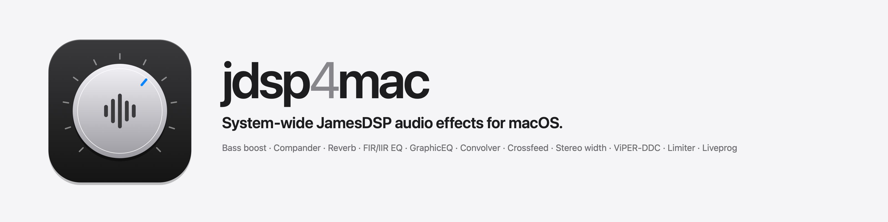
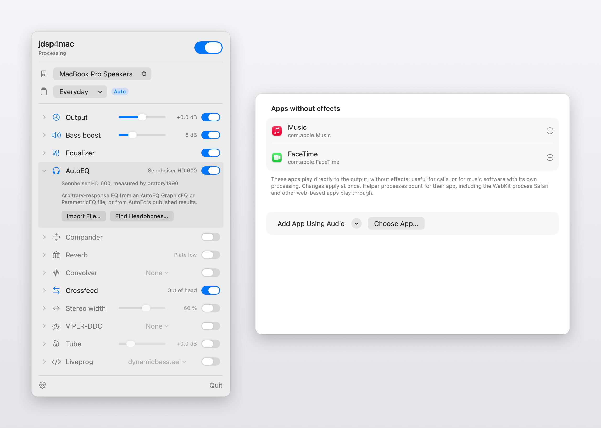

# jdsp4mac

<picture>
  <source media="(prefers-color-scheme: dark)" srcset="docs/images/readme-banner-dark.png">
  
</picture>

jdsp4mac puts JamesDSP on your Mac as a menu bar app. Everything your Mac plays goes through [libjamesdsp](https://github.com/james34602/JamesDSPManager), the same DSP engine behind JamesDSP for Android and [JamesDSP for Linux](https://github.com/Audio4Linux/JDSP4Linux). Audio comes in through a Core Audio process tap. There is no kernel extension, no virtual audio driver and nothing to reboot.

- **Effects.** Bass boost, FIR and IIR equalizer with JDSP4Linux's 18 built-in presets, AutoEQ arbitrary-response EQ, compander, reverb, convolver with impulse responses, BS2B and HRTF crossfeed, stereo width, ViPER-DDC, vacuum tube and liveprog EEL2 scripts.
- **Presets.** jdsp4mac uses the JamesDSP for Linux `audio.conf` format. It imports presets from JamesDSP for Linux, RootlessJamesDSP `.tar` backups and JamesDSP for Android `james.dsp.*.xml` files, and exports to Linux and RootlessJamesDSP. A preset can load by itself whenever a given output device becomes active.
- **AutoEQ.** Search the headphone profiles published by [AutoEq](https://github.com/jaakkopasanen/AutoEq) and apply one, or import a GraphicEQ or ParametricEQ file.
- **Apps without effects.** Pick apps that should skip the effects, such as FaceTime for calls. Safari works too.
- **`jdspctl`.** Command-line control with the same options as the JamesDSP for Linux remote, for scripts, Shortcuts and Raycast.

<picture>
  <source media="(prefers-color-scheme: dark)" srcset="docs/images/hero-dark.png">
  
</picture>

jdsp4mac needs macOS 14.4 or later on Apple silicon. I have only tested it on macOS 27.0.1 on an M1 Pro MacBook Pro.

## Install

jdsp4mac is free and only distributed here, so Apple has not notarised it. macOS blocks it the first time you open it, and you allow it once.

1. Download `jdsp4mac-<version>-arm64.zip` from [Releases](../../releases), unzip it and move `jdsp4mac.app` to Applications.
2. Open it. macOS shows **"jdsp4mac.app" Not Opened** and says Apple could not verify it is free of malware. Click **Done**, not Move to Bin.
3. Open **System Settings › Privacy & Security**, scroll down to Security and click **Open Anyway** next to the jdsp4mac message. Click **Open Anyway** again in the next dialog and confirm with Touch ID or your password.

   Control-click › Open stopped working for this in macOS Sequoia. If you prefer Terminal, this does the same:
   ```sh
   xattr -dr com.apple.quarantine /Applications/jdsp4mac.app
   ```
4. The jdsp4mac icon, a ring with three bars, appears in the menu bar. Click it and switch the power on. macOS asks whether jdsp4mac may record system audio. Click **Allow**. That is how it hears what your Mac plays. It never saves or sends your audio anywhere.

If you clicked Don't Allow, the panel says there is no audio from the tap. Turn jdsp4mac on under **System Settings › Privacy & Security › Screen & System Audio Recording**, in the "System Audio Recording Only" list, then quit and reopen jdsp4mac.

### Updates

When a new version is out, the panel shows it. Click **Install** and jdsp4mac downloads the update, checks that it is signed with the same certificate as the copy you have, replaces itself and reopens. Updates installed this way skip the Open Anyway step and keep the audio recording permission.

Versions 0.1.2 and earlier can't do this. Install 0.1.3 by hand once, as above, and allow audio recording once more. In-app updates work from then on.

## Use

Daily use happens in the menu bar panel. It has the power switch, the output device, presets and one row per effect. Click a row to open its settings. The switch on the **Output** row turns all effects off and on at once.

The panel works from the keyboard too. ↑ and ↓ move between effects, ← and → adjust the selected one, Space switches it on or off, Return opens its settings and Esc closes the panel.

In Settings › General you can record global shortcuts that turn effects on or off and switch to the next or previous preset from any app. None are set until you record them.

Boosting EQ bands can push loud music into the limiter. Turn on **Automatic headroom** on the Output row and jdsp4mac lowers the output by the equalizer's highest boost, up to 15 dB, less any cut your post gain already makes. Double-click an EQ band to reset it to 0.

The Output row also has a **Balance** slider for headphones or hearing that lean to one side. It lowers the opposite channel, stays set when you change presets, and turns off with the rest of the effects.

jdsp4mac goes online for three things only. It searches AutoEq's profiles when you use AutoEQ search, it asks GitHub for the latest release at launch and once a day, and it downloads an update from GitHub when you click Install. You can turn the update check off in Settings › General.

The gear icon opens the settings window. It holds preset management, AutoEQ search, the liveprog script editor, the list of apps without effects, presets per output, open at login and diagnostics.

jdsp4mac comes with five starter presets (Bass, Vocal, Movie, Headphone Room and Concert Hall) and the liveprog scripts, impulse responses and ViPER-DDC files that JamesDSP for Linux ships. They are copied once. Files you already have are never replaced, and anything you delete stays deleted unless you restore it. The starter presets lower their own output to leave room for their EQ, so raise the volume if one sounds quiet.

After you change a loaded preset, the panel shows it as edited and offers **Save Changes**. **Settings › Presets** lists every preset, where you can load, overwrite, rename, duplicate, export or delete it, and bring back deleted starter presets. jdsp4mac asks before replacing a preset, and deleted presets go to the Trash.

Your files live in `~/Library/Application Support/jdsp4mac/`.

| File or folder | Contents |
|---|---|
| `audio.conf` | Current settings in the JamesDSP for Linux format. Edits apply live. |
| `presets/` | Presets |
| `excluded-apps.txt` | Bundle IDs of apps that play without effects, one per line |
| `irs/`, `vdc/`, `liveprog/` | Impulse responses, ViPER-DDC files and liveprog scripts |

Presets from Linux point at files by their Linux path. jdsp4mac looks the files up by name in these folders instead.

### jdspctl

`jdspctl` ships inside the app. Link it into your PATH to use it from Terminal:

```sh
sudo mkdir -p /usr/local/bin && sudo ln -sf /Applications/jdsp4mac.app/Contents/MacOS/jdspctl /usr/local/bin/jdspctl
```

```sh
jdspctl --status
jdspctl --set bass_enable=true bass_maxgain=8
jdspctl --load-preset "My headphones"
jdspctl --list-devices
jdspctl --set-preset-rule "BuiltInSpeakerDevice=Speakers"
jdspctl --help
```

`jdspctl` edits the same files the app watches. Changes apply straight away while jdsp4mac runs, and they still work when it isn't running.

## Limitations

- Stereo only. Outputs with more than two channels play unprocessed.
- To leave out an app's helper processes, including the WebKit process Safari plays through, jdsp4mac asks macOS which app is responsible for each process. That is a private macOS call. If a future macOS drops it, only the app's own process gets excluded, and the log says so.
- Run one tap-based audio app at a time. Other apps that use process taps on the same output, FineTune for example, reportedly stop each other from starting. Quit them if jdsp4mac stays on "Starting".
- Long convolver impulse responses cost CPU in proportion to their length. On an M1 Pro a 5 s IR takes about 13 % of a core and a 20 s IR about 25 %. Typical room and headphone IRs are under 2 s.
- Apple has not notarised the app. See Install.

## Build from source

```sh
brew install xcodegen
xcodegen && xcodebuild -scheme jdsp4mac -configuration Debug build
```

Debug builds are ad-hoc signed by default, so macOS asks for the audio recording permission again after every rebuild. To keep the permission, sign them with a free Apple Development certificate as described in `xcconfig/Signing.xcconfig`.

`scripts/build-release.sh` signs release builds with the project's self-signed certificate when `SIGNING_P12_BASE64` and `SIGNING_P12_PASSWORD` are set, and ad-hoc otherwise. A fork's releases need a certificate of its own (`scripts/make-signing-cert.sh`).

`scripts/build-release.sh [version]` builds the ad-hoc signed release zip with `jdspctl` inside. On GitHub, Actions › build › Run workflow does the same and publishes a release for the version you enter. `scripts/screenshots.sh [dir]` renders the running app with demo settings for screenshots and saves nothing.

`Tests/golden.sh` checks the DSP offline. `Tests/phase2.sh`, `phase3.sh`, `phase5.sh` and `exclusion.sh` test the live app. They play quiet tones and need the audio recording permission.

## Credits and licence

- libjamesdsp is by James Fung ([JamesDSPManager](https://github.com/james34602/JamesDSPManager)). jdsp4mac uses the copy maintained in [JDSP4Linux](https://github.com/Audio4Linux/JDSP4Linux) by Tim Schneeberger, whose preset format, CLI and built-in EQ presets it follows.
- The bundled liveprog scripts, impulse responses and ViPER-DDC files come from JDSP4Linux. Scripts by other authors keep their notices inside the files.
- Headphone profiles come from [AutoEq](https://github.com/jaakkopasanen/AutoEq) by Jaakko Pasanen. The measurements belong to the sources named with each profile.
- The panel layout takes ideas from [FineTune](https://github.com/ronitsingh10/FineTune). No FineTune code is used.

jdsp4mac is licensed GPL-3.0-or-later. See `LICENSE`, and `docs/licences.md` for the bundled third-party code.
